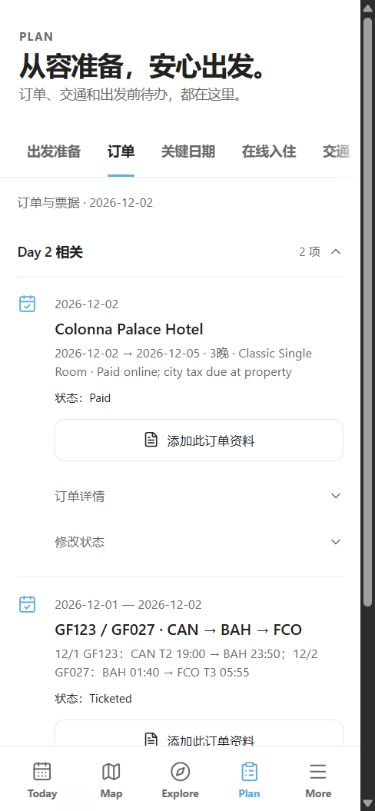
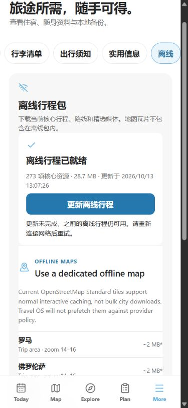
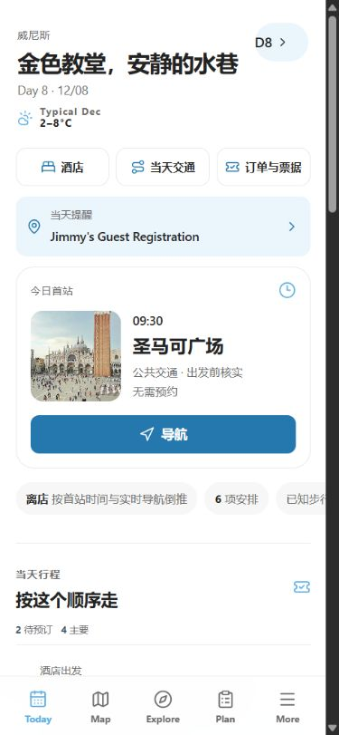

# 并行实用性优化 · 2026-10-13

用户授权主线程作为经理开其他 Codex 任务同步优化。两个代码任务分别负责手机/桌面操作边界与离线更新可靠性；主线程独占浏览器、构建、审计、脏文件保护和提交。修改前远端 QA 分支是 `30ac563794392d4427b8737efe06b969337c1fc1`。保持自动任务已删除、外部 High 已取消、无生产部署。

## 操作入口可靠性

手机和桌面原先允许修改已出票国际机票状态，但控制器立即强制恢复 Ticketed；订单派生完成的待办/关键日期也提供会立即被覆盖的撤回入口。桌面已出票交通仍能写入偏好。

两端现在复用同一纯判定：已出票订单展示固定状态，订单派生完成说明来源，已出票航段/候选不提供偏好写入。正常订单、手动待办、入住和未出票交通原操作保留，处理器也拒绝无效写入，没有改出票事实或派生规则。详见 [分工审查](mobile-review.md)。

主线程在最终生产构建的独立 `127.0.0.1:3009` 实测：两张桌面国际机票没有 select；手机 D2 机票没有修改控件，保留详情/资料入口。将隔离斗兽场订单从 Research 改 Booked 后，任务和关键日期实际只读并显示订单来源；切回 Research 后可编辑入口恢复。桌面两张已出票航段偏好按钮为 0，其他五段各有原来的 3 个候选入口。未点击真实3000状态或偏好。

切回 Research 只恢复显示状态，会增加显式覆盖键，因此不把它称为逐字段撤销。随后使用初始 UI 导出文件，通过正式选择器和原生确认恢复，停服状态也能重载；再次 UI 导出的 9 组业务字段完全相同于初始基线。私人导出仅留本机，未入仓库。

## 本机资料

保存增加同步互斥和等待状态，等待期间锁定草稿，失败保留文件可重试；读取/删除失败显示反馈，存储尚在读取或不可用时不再误称离线就绪。预览改用原生 dialog 并复用既有生命周期，恢复焦点、Tab 范围、Escape 与背景滚动。Blob URL 只在本机创建/释放；图片保持浏览器本地渲染，禁止进入图片优化服务。

在独立 `localhost:3008`，先 UI 导出且确认资料0份，只保存一张仓库现有公开巴黎 PNG 副本，标题 QA document preview。资料显示1份并在刷新后保留；打开后聚焦 Close document，Shift+Tab 到 Open full screen，Tab 回到关闭，Escape 后焦点回 Open、背景滚动恢复。手机最终原生 dialog 画面和实际图片完整绘制。PDF 内部插件键盘与全屏链接打开没有实测，不将图片预览证据扩大到这些范围。

资料操作前后旅行备份9组字段相同。该公开测试资料只保留在隔离3008，不包含在JSON备份中；没有永久删除测试，也未读写用户真实资料、票据或签证文件。

## 离线更新

修复旧包仍引用新版 HTML、半成品参与回退、信任 localStorage 成功标记、重复下载/离页后无法接续和资源响应卡住的问题。完整包通过已提交指针同时发布 HTML/代码，只有内容检查通过的包才称就绪，失败保留原包。已打开旧页面的前版懒模块仍可使用。资源计数按清单去重，显示273项/28.7MB。详见 [离线源码与模型审查](offline-review.md)。

实际最终构建下载到9/273时离开页面，重回离线页读到完成状态。第一次尝试在更新中停服，但更新已先完成，不能作为失败证据；该误标诊断图未提交。服务器已停后重新点击更新，实际出现“更新未完成，之前的离线行程仍可用”，就绪及原时间仍保留。停服且更新失败后，未访问的 Day18、Day15直接导航，Day15刷新、核心照片和首次Explore加载通过。首页/Today没有提前创建地图，手机无横向溢出。

跨版本下载失败、配额失败、丢失缓存、卡住响应和并发有 Node 实际组件/worker 模型证据；本轮原始浏览器失败例为同构建停服，不能扩大成跨版本失败 E2E。完整外部断网仍未测，用户选择先完成可自动执行项；外部网络未关闭，地图瓦片不算离线证据。

独立只读复查另外确认旧 shell 升级会删掉已提交指针，使完整资源失去接续入口。现已改为稳定的 `europe-travel-os-pack-metadata-v1`，只迁移旧 shell 的已发布且完整记录；无记录的 pending 缓存不被采纳。迁移写入因配额失败时保留旧 shell 和可用指针，下载等待迁移后才发布新包。实际 worker 源码模型覆盖 v11→v12→v13、迁移配额失败/重试、无记录 pending、坏内容和迁移/下载并发；独立复查确认原 P2 解决，未见遗留阻断项。

该修复后重新完整检查与构建，再在同一隔离3009验证。浏览器请求新版 `sw.js`，回源确认服务提供 v12 与稳定元数据实现；重载后仍显示原273项和13:07:26时间。停止自己的服务器再点击更新，失败提示与原就绪状态保留；本轮未访问的Day8直接打开并刷新，5张核心照片完整、地图0、页面宽与滚动宽同为375。只读DOM不检查active worker运行变量，因此精确版本迁移与跨版本失败仍按源码/模型证据记录。验收前后UI导出九组业务字段与已恢复基线完全相同。

## 检查、证据与边界

最终 v12 迁移修复后重新执行统一 `pnpm check`（typecheck、项目lint、build、项目audit）和18项回归全部通过，资料组件/worker补充源码 lint 通过。新边界脚本执行真实组件处理器/worker，存储与 React 用隔离适配，并非浏览器 storage 注入。项目审计0 failures、1个既有预算警告（27630对26000），没有依赖升级。整份execution-cards的额外lint报原有未使用day参数；与改动的DeadlineCenter无关，记录保留，不假称该整文件检查通过。

最终构建新 origin 首页原始 LCP 2848ms，暖刷新692ms，首字节255/182ms；冷JS传输340831 bytes。保留这个较慢冷样本，不因旧测量或暖样本宣称所有环境性能达标，没有生产field/p75/INP/CLS结论。

实际原始JPEG尺寸由sharp独立读取：普通手机375×811，资料dialog390×843，CSS请求390×844。只提交完整绘制的viewport，不拼图，不提交旧section预览或误标失败画面。此前 evidenceCorrection 保持不变，详见 `acceptance.json`。

原始10个生成脏文件从独立快照恢复并比较SHA256，原其他untracked不碰。测试服务只停止自己启动的实例，收尾恢复3000。源data/lib/package/lock、地图、用户图片/头像和旅行事实保持。仅提交本轮明确文件，不部署，不恢复自动任务，全局complete=false。
