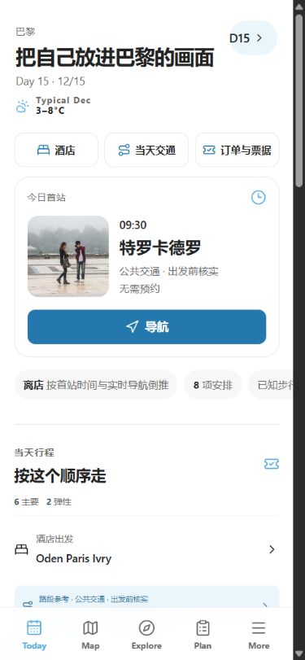
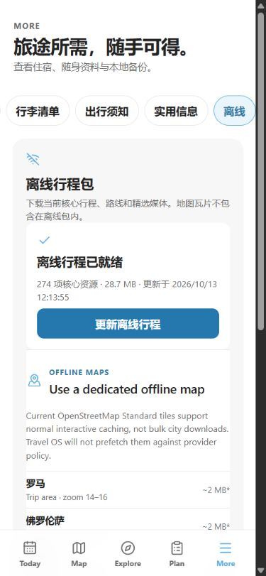

# 恢复、离线与性能验收 · 2026-10-13

本轮人工要求自主运行、发现问题直接修复。外部 High 复核和旧定时任务均不恢复。修改前远端 QA 分支确认是 `78aaf4ace5c600a64fbdef929af4507d29200c23`，可作为回退基线。本轮未部署；最近已知生产仍是 `395cb61`。

## 实际恢复

正式 CUA 内置 Browser 文件选择器，在独立 `127.0.0.1:3002/3005` 操作，真实 3000 业务数据没有写入。修改状态前 UI 导出，私人导出/fixture 只在本地临时目录和 Downloads 比较，未加入仓库。

- 坏 JSON 显示“无法读取这个 JSON 备份，未覆盖当前数据”。
- 有效 V5 在原生确认框取消后，UI 再导出的 9 组业务字段与原始导出完全相同。
- V5 接受后，UI 再导出的当前行程、自定义项目、订单状态、任务状态、实际支出、备注、收藏、交通偏好与行李均与隔离 fixture 逐字段相同。
- V3 任务转换为 `task:qa-restore-legacy=Doing`，保留当前交通偏好与行李；V4 保留行李并接受交通偏好。国际航班已出票导出的 `deadline:transport-international=Done` 来自既有派生规则，未改算法。
- UI 恢复各自原始导出后，9 组字段完全一致；停服巡检后的 UI 导出仍完全一致。测试项目经基线恢复撤回，没有永久删除测试。

本轮 IAB 正式 filechooser 能选择文件，历史 Chrome 文件 URL 权限阻碍没有被绕过。未读取或上传私人随身资料、签证文件。

## 两处实际离线问题

原实现只保存已加载脚本：桌面下载后停服，首次移动 More 报 `MobileMore-jobEu6wG.js` 下载失败。构建现在生成包含所有懒模块、CSS、字体及应用图片的清单，离线下载同时保存媒体和应用代码，下载失败保留旧包。

多次构建后，未访问日期的导航回退还用了旧 HTML，引用 `index-BX3jiFXX.js`，与当前应用包失配。离线包现在包含当前 `/` HTML，所有资源成功后先保存匹配入口，再清理旧 HTML 导航缓存；写入纳入 worker 生命周期，清单网络优先。

最终包显示 **274 项 / 28.7 MB**，worker 按 URL 去重，显示计数含清单交集。停止自己启动的 3005 服务器并确认无监听后：

- 未访问 Day 15 直接导航和刷新成功，原先失败的 Day 8 直接导航成功。
- 首次 Explore、Plan、More 及城市筛选成功；核心图片 complete=true 且有真实像素尺寸，没有横向溢出。
- Home/Today 未创建地图，点击 Map 后只有一个实例；推荐地点 Drawer 覆盖地图且能关闭。实例复用有原有源码/回归保障，地图代码未改。
- 停服后的 UI 导出与原始基线 9 组业务字段完全相同。

**完整外部断网仍未实测。** 外部网络一直可用，地图瓦片与路线服务不算离线证据。IAB 正式接口没有 Network Offline/节流，Chrome 未连接；已发必要的 Chrome 重连请求，之后还需隔离标签页的 DevTools Network Offline。没有 raw CDP、浏览器 storage 注入、杀浏览器、关闭全机网络或扩展权限绕过。

## 实测性能

最终生产构建、可见 IAB、无 CPU/网络节流，读取应用 DOM 性能标记。新增首字节和 JS 响应结束标记，没有遥测上传。`homeJsReadyMs` 是最晚观测的 JS responseEnd，并非执行完成；缓存 transferSize=0 并非零 JS。

| 最终构建 | TTFB | Home 挂载 | LCP |
| --- | ---: | ---: | ---: |
| 桌面冷加载，新 origin 3006 | 280 ms | 914 ms | 1084 ms |
| 手机冷加载，新 origin 3007 | 173 ms | 843 ms | 1180 ms |
| 桌面暖刷新 1 | 263 ms | 643 ms | 884 ms |
| 桌面暖刷新 2 | 74 ms | 222 ms | 472 ms |
| 手机暖刷新 1 | 100 ms | 224 ms | 596 ms |
| 手机暖刷新 2 | 39 ms | 220 ms | 468 ms |

两个新 origin 冷加载 JS transferSize 均为 340012 bytes，首页地图实例始终为 0。桌面原图 PNG 2,585,363 bytes 无损编码为 WebP 1,560,190 bytes，减少约 39.65%；逐像素一致，原 PNG fallback、手机图片与头像保留。

旧 PNG 的 LCP 1.620/4.212/0.556 秒，以及 WebP 在诊断重构建前的 3.800/4.440 秒仍保留于 `acceptance.json`。最终局部冷/暖测量通过，不能据此把此前慢样本视为全部解决。没有生产真实用户 p75、INP、CLS 或节流测量，不能宣称生产 Core Web Vitals 全部达标。[LCP 官方说明](https://web.dev/articles/lcp) 要求区分实验测量和真实用户分布。

## 检查与保护

`pnpm check`（lint/typecheck/linkage/build/项目 audit）和全部 14 项回归通过；HTML 写入顺序审查后最终 lint/build 通过；最后追加导航回退回归通过并重新 lint。项目审计 0 failures、1 个既有预算警告（27630 对 26000）。未夹带依赖升级，不将 pnpm audit 当项目审计。

新增离线回归覆盖未访问懒模块、版本失效、缺失资源拒绝、下载失败保留旧包、HTML 更新，以及 fetch 拒绝时未访问导航使用当前入口。V3/V4/V5 模型回归和真实恢复均通过。

开始时 10 个用户/生成脏文件从独立快照恢复，并逐文件 SHA256 比较；只提交本轮文件。其他原有 untracked 截图/报告不碰。data/lib/pnpm-lock 无修改。测试服务器只停止自己启动的实例，3000 开发服务恢复；未部署。

收尾时浏览器安全策略拒绝临时标签清理/视口复位，判定 URL 协议不支持，已停止这一步，没有换接口绕过。临时标签清理与视口复位结果未确认。3000 重启曾因 OneDrive 新截图文件 EBUSY 退出，文件写入完成后重启成功，HTTP 200；没有修改监视器设置或终止未知进程。

## 证据修正

`acceptance.json` 保存原始 JPEG 实际尺寸。CSS 390×844 大多返回 375×811，Drawer 返回 390×843；桌面冷加载 CSS 1280×720 返回 1265×712；恢复截图为 598×746。文件名使用实际像素。原始已绘制 viewport 截图，无拼接、无未绘制 full-page；历史 evidenceCorrection 保持不变。

恢复与本地运行性能已取得实际验收；同源停服离线已修复并复测。完整外部断网仍待控制条件，整体 QA complete=false，旧 3001 清理与全系统满意没有假定完成。
